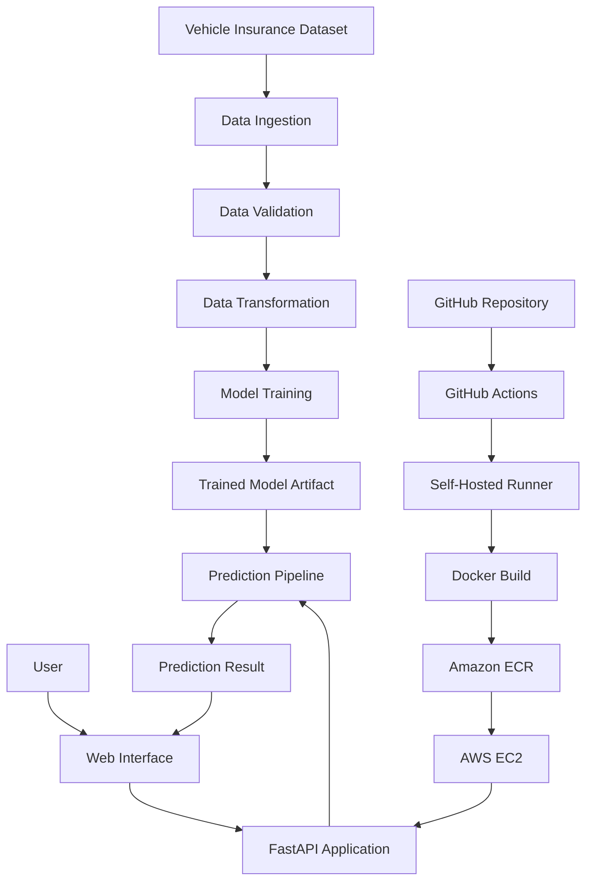
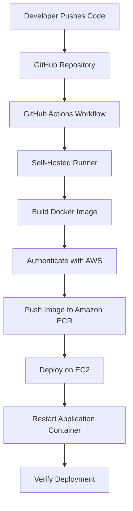

# 🚗 InsureIQ — End-to-End Vehicle Insurance MLOps Platform

<p align="center">
  <strong>From Machine Learning to Production with Automated CI/CD</strong>
</p>

<p align="center">
  <a href="http://13.218.104.30:5000/">🌐 Live Demo</a> •
  <a href="https://github.com/titasmal75-wq/InsuranceX">💻 Source Code</a> •
  <a href="http://13.218.104.30:5000/docs">📚 API Documentation</a>
</p>

<p align="center">
  
  
  
  
  
</p>

---

## 📌 Overview

**InsureIQ** is an end-to-end Machine Learning Operations (MLOps) project that predicts customer responses to vehicle insurance offers using a trained classification model.

The project focuses on the complete machine learning lifecycle, from data ingestion and validation to model training, prediction, containerization, and cloud deployment.

Unlike a standalone machine learning notebook, InsureIQ uses a modular Python architecture, a FastAPI web application, Docker, AWS infrastructure, and a GitHub Actions deployment workflow.

The primary objective is to demonstrate how machine learning models can be integrated into maintainable applications and deployed to a cloud environment.

### 🎯 Project Goals

- Develop a machine learning pipeline for vehicle insurance response prediction.
- Organize the codebase into reusable and maintainable modules.
- Automate data processing and model training through a pipeline.
- Serve predictions through a web application built with FastAPI.
- Package the application using Docker.
- Deploy the containerized application on AWS EC2.
- Use Amazon ECR to store Docker images.
- Automate deployment using GitHub Actions and a self-hosted runner.

## 🌐 Live Application

**Try InsureIQ:** [http://13.218.104.30:5000/](http://13.218.104.30:5000/)

The application allows users to submit customer and vehicle-related information through a web form and receive a model-generated prediction.

The live application depends on the availability and configuration of the cloud infrastructure.

## ✨ Key Features

- **End-to-End ML Pipeline:** Separates data ingestion, validation, transformation, and model training into modular components.
- **Modular Architecture:** Organizes pipeline logic, configuration, entities, exceptions, logging, and utilities into dedicated packages.
- **Prediction Interface:** Accepts vehicle insurance features through a web form.
- **FastAPI Backend:** Connects the web interface with the prediction and training pipelines.
- **Docker Containerization:** Packages the application and its dependencies into a deployable image.
- **AWS Deployment:** Hosts the application on an EC2 instance.
- **Amazon ECR Integration:** Provides a registry for container images.
- **CI/CD Automation:** Uses GitHub Actions to automate deployment tasks.
- **Interactive API Documentation:** Supports FastAPI's Swagger UI.
- **Reusable Components:** Makes the pipeline easier to maintain, debug, and extend.

## 🛠️ Technology Stack

| Category | Technologies |
|---|---|
| Language | Python |
| Machine Learning | Scikit-learn |
| Data Processing | Pandas, NumPy |
| Backend Framework | FastAPI |
| ASGI Server | Uvicorn |
| Frontend | HTML, CSS, Jinja2 templates |
| Architecture | Modular Python packages |
| Containerization | Docker |
| CI/CD | GitHub Actions |
| Cloud Computing | AWS EC2 |
| Container Registry | Amazon ECR |
| Version Control | Git, GitHub |
| Development | VS Code, Jupyter Notebook |

## 🏗️ System Architecture



### Architecture Explanation

1. **Data Ingestion:** Retrieves and prepares the input dataset for processing.
2. **Data Validation:** Checks that the data meets the pipeline's expected requirements.
3. **Data Transformation:** Applies the necessary preprocessing and feature transformations.
4. **Model Training:** Trains a classification model using the prepared data.
5. **Model Artifact:** Stores the trained model and required artifacts for inference.
6. **Prediction Pipeline:** Loads the trained model and processes new input data.
7. **FastAPI Application:** Connects the prediction pipeline to the web interface.
8. **Docker and AWS:** Package, distribute, and run the application in the cloud.

## 🧠 Machine Learning Workflow

InsureIQ is designed around a modular machine learning pipeline.

### 1. Data Ingestion

The data ingestion layer retrieves the source data and prepares it for downstream processing.

### 2. Data Validation

The validation stage checks data quality and compatibility with the expected schema.

### 3. Data Transformation

The transformation stage prepares features in the format required by the trained model.

### 4. Model Training

The training pipeline fits a classification model and generates the artifacts needed for inference.

### 5. Prediction

The prediction pipeline accepts customer and vehicle information, constructs the input features, and generates a prediction.

### Input Features

The application uses the following feature fields:

- Gender
- Age
- Driving License
- Region Code
- Previously Insured
- Annual Premium
- Policy Sales Channel
- Vintage
- Vehicle Age Less Than One Year
- Vehicle Age Greater Than Two Years
- Vehicle Damage

The model predicts the customer's response to a vehicle insurance offer.

**Important:** This is a customer-response prediction task, not a system for calculating insurance premiums or determining the actual price of an insurance policy.

## 🔄 CI/CD Pipeline

InsureIQ uses a GitHub Actions workflow located at:

` .github/workflows/aws.yaml `

The deployment process is designed to automate application delivery from source code to the cloud.

### Deployment Workflow



### Pipeline Stages

1. **Source Control:** Changes are committed and pushed to GitHub.
2. **Workflow Trigger:** GitHub Actions starts the configured deployment workflow.
3. **Runner:** The self-hosted runner executes the configured commands.
4. **Docker Build:** The application image is built from the Dockerfile.
5. **Image Publishing:** The image is tagged and pushed to Amazon ECR.
6. **Deployment:** The EC2 deployment process retrieves and runs the updated image.
7. **Verification:** The application is checked after deployment.

The precise steps depend on the commands configured in `aws.yaml`.

## ☁️ AWS Deployment

The application is hosted on AWS using container-based deployment.

| AWS Component | Responsibility |
|---|---|
| Amazon EC2 | Runs the application container |
| Amazon ECR | Stores Docker images |
| IAM | Controls access to AWS resources |
| GitHub Actions | Automates the deployment workflow |

### Deployment Information

- Application name: `InsureIQ`
- Application port: `5000`
- AWS region: `us-east-1`
- ECR repository: `vehicleproj`
- Container registry: Amazon ECR
- Application server: Uvicorn through the FastAPI application entry point

### Security Best Practices

- Store credentials in GitHub Actions secrets or use an appropriately configured IAM role.
- Do not commit AWS credentials or `.env` files.
- Restrict inbound EC2 traffic to the required ports.
- Use HTTPS through a properly configured reverse proxy for production access.
- Restrict access to the model training endpoint before exposing it publicly.

## 📂 Project Structure

The following structure reflects the directories and files visible in the repository.

```text
InsuranceX/
│
├── .github/
│   └── workflows/
│       └── aws.yaml
│
├── config/
│
├── notebook/
│
├── src/
│   ├── cloud_storage/
│   ├── components/
│   ├── configuration/
│   ├── constants/
│   ├── data_access/
│   ├── entity/
│   ├── exception/
│   ├── logger/
│   ├── pipline/
│   └── utils/
│
├── static/
│
├── templates/
│
├── .dockerignore
├── .gitignore
├── .project-root
├── app.py
├── demo.py
├── pyproject.toml
├── README.md
├── requirements.txt
├── setup.py
└── template.py
```

### Important Directories

| Directory | Purpose |
|---|---|
| `config/` | Project configuration files |
| `notebook/` | Exploratory analysis and experiments |
| `src/components/` | Data and model pipeline components |
| `src/cloud_storage/` | Cloud storage integration |
| `src/configuration/` | Configuration and service connections |
| `src/constants/` | Shared project constants |
| `src/data_access/` | Data access and retrieval logic |
| `src/entity/` | Configuration and artifact entities |
| `src/exception/` | Custom exception handling |
| `src/logger/` | Logging configuration |
| `src/pipline/` | Training and prediction pipelines |
| `src/utils/` | Shared utility functions |
| `static/` | Static frontend assets |
| `templates/` | HTML templates rendered by FastAPI |
| `.github/workflows/` | Automated CI/CD configuration |

## ⚙️ Getting Started

### Prerequisites

Install the following tools before running the project:

- Python 3.10
- Git
- Docker (optional for local container execution)
- AWS CLI (only if interacting with AWS resources)
- Access to any external services required by your configuration

### 1. Clone the Repository

```bash
git clone https://github.com/titasmal75-wq/InsuranceX.git
cd InsuranceX
```

### 2. Create a Virtual Environment

On Windows PowerShell:

```powershell
python -m venv venv
.\venv\Scripts\Activate.ps1
```

If PowerShell blocks script execution, activate the environment using Command Prompt instead:

```bat
venv\Scripts\activate.bat
```

### 3. Install Dependencies

```bash
python -m pip install --upgrade pip
pip install -r requirements.txt
```

### 4. Configure Environment Variables

Create a `.env` file in the project root and configure the variables required by your application and external services.

Do not publish credentials or other sensitive values in the repository.

### 5. Run the Application

```bash
python app.py
```

The application entry point starts the configured FastAPI server.

Open the local application:

`http://127.0.0.1:5000/`

Open the interactive API documentation:

`http://127.0.0.1:5000/docs`

### 6. Run the Training Pipeline

The project exposes a training route:

```text
GET /train
```

For a local instance, you can trigger it using:

```powershell
Invoke-RestMethod -Uri "http://127.0.0.1:5000/train" -Method Get
```

This route executes the training pipeline. Run it only in a trusted environment because model training can consume compute and other resources.

## 🐳 Docker Deployment

The repository includes a Dockerfile based on Python 3.10.

### Build the Image

From the project root:

```bash
docker build -t insureiq:latest .
```

### Run the Container

```bash
docker run -d --name insureiq -p 5000:5000 insureiq:latest
```

### Verify the Container

```bash
docker ps
docker logs -f insureiq
```

Visit:

`http://127.0.0.1:5000/`

### Stop the Container

```bash
docker stop insureiq
docker rm insureiq
```

## 🔌 Application Routes

The currently implemented routes include:

| Method | Route | Description |
|---|---|---|
| `GET` | `/` | Displays the vehicle insurance prediction form |
| `POST` | `/` | Accepts form input and returns a prediction |
| `GET` | `/train` | Executes the model training pipeline |
| `GET` | `/docs` | Provides interactive Swagger documentation |

The prediction form accepts the required vehicle insurance features and returns a response classification.

## 🧪 Experiments and Development

The repository includes a `notebook/` directory for experimentation and a `demo.py` entry point for development or pipeline execution.

Use these resources to explore the dataset, investigate features, validate the model, and test changes before deploying an updated application.

Model evaluation should be based on actual experiment outputs, using suitable classification metrics such as precision, recall, F1-score, and the confusion matrix.

## 🔮 Future Improvements

InsureIQ can be extended with additional production-oriented MLOps capabilities:

- **Experiment Tracking:** Integrate MLflow to record experiments and model metrics.
- **Data Versioning:** Use DVC to manage dataset and artifact versions.
- **Model Monitoring:** Track model performance, input distributions, and prediction latency.
- **Data Drift Detection:** Detect changes in incoming data distributions.
- **Automated Testing:** Add unit tests, integration tests, and model validation checks to CI/CD.
- **Model Explainability:** Integrate SHAP to explain individual predictions.
- **Observability:** Introduce structured logs, monitoring dashboards, and alerts.
- **Secure Deployment:** Configure HTTPS, restricted network access, and endpoint authentication.
- **Deployment Rollback:** Retain previous image versions to support recovery from failed deployments.

## 🎓 What I Learned

This project helped me work across the practical stages of an ML application lifecycle:

- Designing a modular Python project.
- Building a reusable machine learning pipeline.
- Serving predictions through FastAPI.
- Packaging applications with Docker.
- Deploying containerized applications on AWS.
- Managing container images with Amazon ECR.
- Automating delivery with GitHub Actions.
- Debugging environment, container, and deployment issues.

## 👨‍💻 Author

**Titas Mal**

Computer Science and Engineering | AI/ML | MLOps

- GitHub: [@titasmal75-wq](https://github.com/titasmal75-wq)
- Repository: [InsuranceX](https://github.com/titasmal75-wq/InsuranceX)
- Live Project: [InsureIQ](http://13.218.104.30:5000/)

---

<p align="center">
  <strong>InsureIQ — Building, Deploying, and Operationalizing Machine Learning.</strong>
</p>
